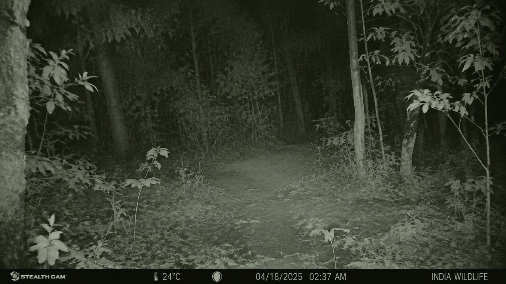

 
<div align="center">

# 🌿 EcoVision

### 🐅 AI-Powered Wildlife Camera Trap & Monitoring Dashboard

**AI • YOLO11 • Computer Vision • IoT • Raspberry Pi • FastAPI • Supabase**

<br/>


<br/><br/>


### 🌍 Making Wildlife Monitoring Smarter with Edge-Based Detection

</div>

---

# 📑 Table of Contents

- [About EcoVision](#-about-ecovision)
- [Problem Statement](#-problem-statement)
- [Our Solution](#-our-solution)
- [Key Features](#-key-features)
- [System Architecture](#-system-architecture)
- [Technology Stack](#-technology-stack)
- [Hardware Components](#-hardware-components)
- [AI & Machine Learning](#-ai--machine-learning)
- [How It Works](#-how-it-works)
- [Dashboard Modules](#-dashboard-modules)
- [Database & Cloud Integration](#-database--cloud-integration)
- [Project Structure](#-project-structure)
- [Installation & Setup](#-installation--setup)
- [Environment Configuration](#-environment-configuration)
- [Running the Project](#-running-the-project)
- [Future Enhancements](#-future-enhancements)
- [Developer Information](#-developer-information)

---

# 📖 About EcoVision

**EcoVision — AI-Powered Wildlife Camera Trap & Monitoring Dashboard** is an intelligent wildlife monitoring system designed to automate animal detection and simplify wildlife observation using Artificial Intelligence, Computer Vision, and Internet of Things (IoT).

Traditional camera traps often generate a large number of unnecessary images due to environmental movements such as wind, shadows, and vegetation. Manually reviewing these images requires considerable time and effort.

EcoVision combines a PIR motion sensor, Raspberry Pi Zero W, USB camera, and YOLO-based object detection model to capture wildlife images and identify animals automatically.

The system sends captured images to a FastAPI backend for AI inference. Detected wildlife information is then stored in Supabase and presented through an interactive monitoring dashboard.

---

# 🚨 Problem Statement

Traditional wildlife monitoring systems face several challenges:

- Large numbers of false-triggered camera images.
- Manual inspection of captured photographs.
- Delayed identification of animal activity.
- Difficulty organizing wildlife observations.
- Limited centralized monitoring and analytics.

EcoVision aims to reduce these challenges through automated image capture, AI-powered animal detection, and centralized wildlife data management.

---

# 💡 Our Solution

EcoVision introduces an intelligent camera trap workflow:

- PIR sensor detects movement.
- Raspberry Pi Zero W captures an image using a USB camera.
- The captured image is sent to a FastAPI backend.
- YOLO11n performs animal detection.
- Detection results and relevant images are stored in Supabase.
- The React dashboard displays wildlife observations and analytics.

**The AI inference runs on the Windows-hosted backend, not directly on the Raspberry Pi Zero W.**

---

# ✨ Key Features

- 🐅 AI-Based Wildlife Detection
- 📸 PIR-Triggered Image Capture
- 🤖 YOLO11n Object Detection
- 🖥️ Centralized Monitoring Dashboard
- 📊 Wildlife Detection Analytics
- 🗺️ Camera Trap Location Visualization
- 🔔 Wildlife Detection Alerts
- ☁️ Supabase Cloud Storage
- ⚡ FastAPI Backend Integration
- 🌐 React-Based Interactive Interface
- 📅 Wildlife Detection History
- 🔍 Species-Based Detection Records

---

# 🏗️ System Architecture

EcoVision follows a distributed IoT and AI architecture.

<div align="center">

```text
       WILDLIFE ENVIRONMENT
                |
                v
          PIR MOTION SENSOR
                |
                v
        RASPBERRY PI ZERO W
                |
                v
          USB CAMERA
                |
                v
       CAPTURED IMAGE
                |
                v
        FASTAPI BACKEND
          (Windows PC)
                |
                v
         YOLO11n MODEL
                |
                v
       ANIMAL DETECTION
                |
                v
           SUPABASE
       (Storage + Database)
                |
                v
        REACT DASHBOARD
                |
                v
      ANALYTICS & ALERTS
```

</div>

---

# 🛠️ Technology Stack

## Frontend

- React.js
- TypeScript
- TanStack Router
- Tailwind CSS
- Vite

## Backend

- Python
- FastAPI
- Uvicorn
- REST API

## Artificial Intelligence & Machine Learning

- YOLO11n
- Ultralytics
- OpenCV
- Computer Vision
- Deep Learning

## Database & Cloud

- Supabase
- Supabase Storage
- PostgreSQL

## Hardware & IoT

- Raspberry Pi Zero W
- PIR Motion Sensor
- USB Camera

## Communication

- HTTP
- REST API
- MQTT components

---

# 🔩 Hardware Components

## 1. Raspberry Pi Zero W

Acts as the main IoT controller and handles sensor monitoring, image capture, and communication with the backend.

## 2. PIR Motion Sensor

Detects movement in the surrounding environment and triggers the image-capture process.

## 3. USB Camera

Captures wildlife photographs when motion is detected by the PIR sensor.

<div align="center">



</div>

---

# 🤖 AI & Machine Learning

EcoVision uses the **YOLO11n object detection model** for wildlife image analysis.

### Model Capabilities

- Animal detection from captured images.
- Bounding-box localization.
- Species classification for supported classes.
- Confidence score generation.
- Automated inference through the backend.

### Model Workflow

1. Receive an image from the Raspberry Pi.
2. Process the image using the YOLO model.
3. Identify supported animal classes.
4. Generate detection confidence and bounding boxes.
5. Return the inference results to the backend.

### Model Evaluation

The model is tested using individual wildlife images. Evaluation metrics such as precision, recall, mAP, and F1-score should be reported only after validation against correctly labeled ground-truth data.

---

# ⚙️ How It Works

### Step 1 — Motion Detection

The PIR sensor continuously monitors the surrounding area.

### Step 2 — Image Capture

When movement is detected, the Raspberry Pi activates the USB camera and captures an image.

### Step 3 — Image Transmission

The captured image is transmitted to the FastAPI backend through an HTTP request.

### Step 4 — AI Inference

The backend processes the image using the YOLO11n model.

### Step 5 — Detection Storage

Relevant wildlife detection information and captured images are stored using Supabase.

### Step 6 — Dashboard Visualization

The React dashboard retrieves the stored information and presents wildlife activity through analytics, detection records, and monitoring modules.

---

# 📊 Dashboard Modules

EcoVision provides a centralized interface for monitoring wildlife activity.

## 🏠 Main Dashboard

Centralized overview of wildlife monitoring activities.

### Includes

- Monitoring overview
- Detection statistics
- Recent wildlife activity
- Camera trap information

## 🐅 Wildlife Detections

Displays detected animals and their associated image records.

### Includes

- Species information
- Detection confidence
- Capture timestamp
- Captured wildlife images

## 📈 Analytics Dashboard

Visualizes wildlife observation data.

### Includes

- Animal detection statistics
- Species distribution
- Detection trends
- Wildlife activity summaries

## 🗺️ Camera Trap Map

Provides a visual representation of camera trap locations and associated monitoring information.

## 🔔 Alert System

Displays wildlife detection events and relevant monitoring notifications.

## 📡 Sensor Monitoring

Provides a dedicated interface for monitoring available camera trap and sensor information.

---

# ☁️ Database & Cloud Integration

EcoVision uses Supabase for cloud-based storage and data management.

### Supabase Storage

Stores captured wildlife images in the `wildlife-captures` bucket.

### Database

Stores structured wildlife detection information.

### Detection Information

Typical detection records include:

- Species name
- Confidence score
- Timestamp
- Camera/device identifier
- Image storage reference

---

# 📁 Project Structure

```text
EcoVision/
│
├── backend/
│   ├── app/
│   │   ├── main.py
│   │   ├── inference.py
│   │   ├── models.py
│   │   ├── db.py
│   │   ├── alerts.py
│   │   ├── broadcast.py
│   │   └── mqtt_client.py
│   │
│   ├── database/
│   │   └── schema.sql
│   │
│   ├── requirements.txt
│   └── test_inference.py
│
├── edge/
│   └── ecovision_edge.py
│
├── public/
│   ├── videos/
│   └── favicon.ico
│
├── src/
│   ├── assets/
│   ├── components/
│   ├── hooks/
│   ├── lib/
│   └── routes/
│
├── .env.example
├── .gitignore
├── package.json
├── vite.config.ts
└── README.md
```

---

# 🚀 Installation & Setup

## 1. Clone Repository

```bash
git clone https://github.com/Kartiksinghparihar/EcoVision.git

cd EcoVision
```

## 2. Frontend Setup

Install dependencies:

```bash
npm install
```

Configure the frontend environment variables using `.env.example`.

## 3. Backend Setup

Navigate to the backend directory:

```bash
cd backend
```

Create a Python virtual environment:

```bash
python -m venv .venv
```

Activate it on Windows:

```powershell
.venv\Scripts\Activate.ps1
```

Install dependencies:

```bash
pip install -r requirements.txt
```

Return to the project root before starting the frontend.

---

# 🔐 Environment Configuration

Create the required environment files using the provided examples.

### Frontend

```env
VITE_SUPABASE_URL=your_supabase_project_url
VITE_SUPABASE_ANON_KEY=your_supabase_anon_key
```

### Backend

Configure your backend environment with the required Supabase credentials, model path, and edge-device authentication key.

**Important:** Never upload real API keys, passwords, or Supabase service-role credentials to GitHub.

---

# ▶️ Running the Project

## Start Backend

From the `backend` directory:

```powershell
uvicorn app.main:app --host 0.0.0.0 --port 8000 --reload
```

Backend health check:

```text
http://localhost:8000/health
```

## Start Frontend

Open another terminal in the project root:

```bash
npm run dev
```

Open the application:

```text
http://localhost:5173
```

## Start Raspberry Pi Edge Device

Connect to the Raspberry Pi Zero W and navigate to the EcoVision project directory.

```bash
cd /home/zerow/ecovision
```

Start the edge application:

```bash
python3 ecovision_main.py
```

Ensure the Raspberry Pi and backend computer are connected to the same network and the configured backend endpoint is reachable.

---

# 🌍 Future Enhancements

- Real-time wildlife monitoring improvements.
- Support for additional animal species.
- Model optimization for edge devices.
- Solar-powered camera trap deployment.
- GPS-based camera trap tracking.
- Advanced wildlife activity analytics.
- Automated conservation alerts.
- Multi-camera monitoring support.
- Historical wildlife movement analysis.

---

# 👨‍💻 Developer Information

<div align="center">

| Kartik Singh Parihar | Khyati Sahu |
|:---:|:---:|
| **IoT & Full Stack Development** | **AI/ML & IoT Development** |
| [GitHub](https://github.com/Kartiksinghparihar) | [GitHub](https://github.com/misspresident-codes) |
| [LinkedIn](https://www.linkedin.com/in/kartik-singh-parihar-973518329/) | [LinkedIn](https://www.linkedin.com/in/khyati-sahu-178506380/) |

**Institution:** Madhav Institute of Technology & Science (MITS), Gwalior, Madhya Pradesh

**Project:** EcoVision — AI-Powered Wildlife Camera Trap & Monitoring Dashboard

</div>

---

# ⭐ Support

If you like EcoVision and appreciate our work towards smarter wildlife monitoring, please consider giving the repository a ⭐ on GitHub.

<div align="center">

### 🌿 Built with ❤️ for Wildlife Conservation

**EcoVision — Observe. Detect. Protect.** 🐅

[GitHub Repository](https://github.com/Kartiksinghparihar/EcoVision)

</div>
